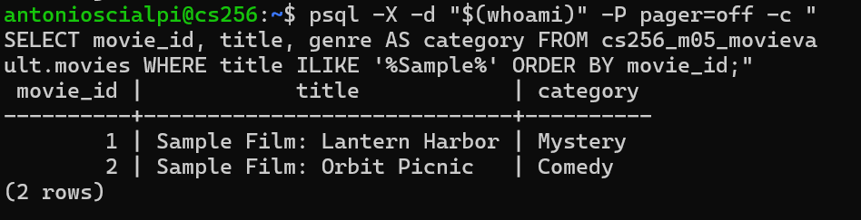
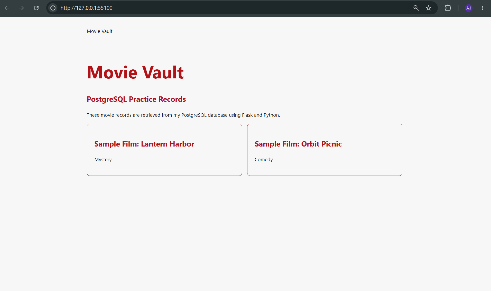

## M05 Reflection

1. One record you read from PostgreSQL and where the same value appeared in the browser.
One record I retrieved from PostgreSQL was "Sample Film: Lantern Harbor" from the movies table. The same movie title appeared on my Flask webpage in the browser, confirming that the database was successfully connected to my application.

2. One to three sentences explaining the table key or relationship used by the query.
The movies table uses movie_id as its primary key to uniquely identify each movie. The reviews table uses movie_id as a foreign key to connect reviews to their corresponding movies. The current query only retrieves records from the movies table.

3. What you completed in your own project during the lab.
During the lab, I created the movies and reviews tables in PostgreSQL and added sample records. I also updated app.py to connect Flask to my database and successfully displayed the records on my webpage. I continued working on the database portion of my MovieVault project.

4. A question or database connection problem that still needs attention, if you have one.
I initially had trouble connecting Python to PostgreSQL because I was entering Python code directly into the Linux terminal. After locating and updating app.py, I was able to get everything working. No remaining connection issues as of now.

5. Your next action.
My next action is to continue developing the MovieVault website by adding images to the movie cards and working on displaying movie reviews from the database.

## M05 Screenshots





# M05 — MovieVault Database Read

## Query and page

My `read_m05_rows()` function in `app.py` reads from `cs256_m05_movievault.movies` using a parameterized filter, `WHERE title ILIKE %s`, with the separate value `('%Sample%',)`. Flask passes the returned dictionary rows to `templates/index.html`, which displays each movie's title and genre (`category`).

## Verified results

| Movie | Genre |
|---|---|
| Sample Film: Lantern Harbor | Mystery |
| Sample Film: Orbit Picnic | Comedy |

These same records appear in the PostgreSQL output and the browser screenshots:
- `
- 

## Tables and keys

```text
movies                         reviews
------                         -------
movie_id (PK)  1 --------- M   review_id (PK)
                                movie_id (FK → movies.movie_id)
```

One movie can have many reviews. The current read queries **movies only**; it does not join `reviews`.

## Environment

PostgreSQL on the King's College CS256 Linux server; project schema `cs256_m05_movievault`. Python, psycopg, and Flask run on the server using its local PostgreSQL socket. The webpage was viewed from Windows through an SSH tunnel.

## AI-use note

I used ChatGPT to troubleshoot terminal commands and the database connection, update my Flask/Python and HTML code, and clarify the lab requirements. I ran and verified the query and webpage myself.
