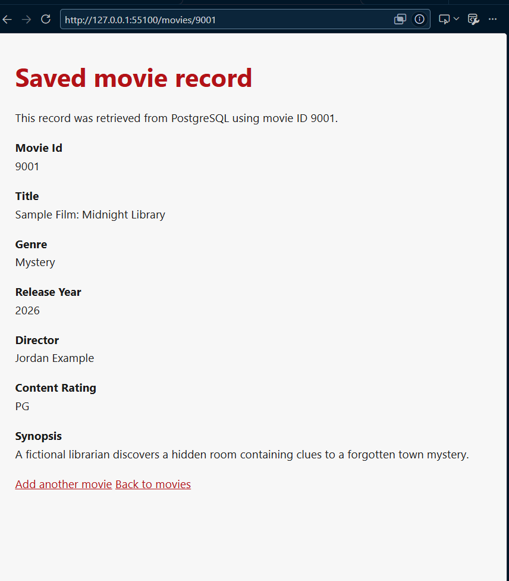
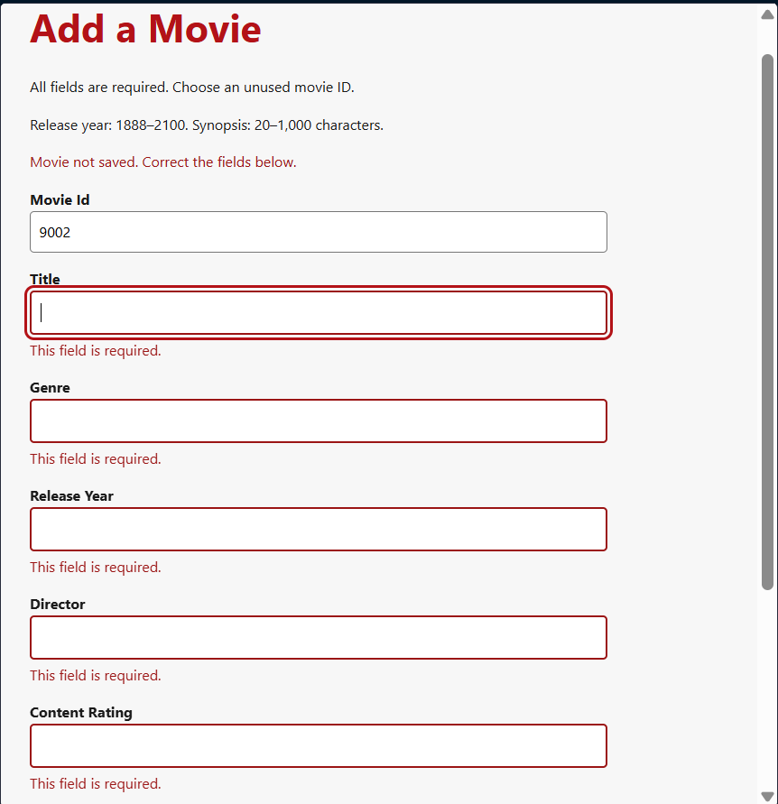

## Activity Questions

1. After creating a fictional local test report, I received this report ID: IR-20260101-BDA0151F.

2. The report stores the information I entered in the form and displays its submission time.

3. When I submitted the same information with a short description, the form rejected it because the description requires at least 20 characters.

4. The injury report form submits named fields through a POST request to the report_injury route. The validate_injury_report function checks the information and returns errors for invalid inputs. After validation and employee verification, create_injury_report uses a parameterized INSERT statement and commits the record to PostgreSQL. Flask then redirects the user to a confirmation page using GET, which displays the saved report ID.

- Used AI to help summarize question 4

## M06 Reflection

1. Successful Local Form Submission

I submitted a fictional injury report for employee E0001234 (Jordan Example). The report was successfully saved, and the confirmation page displayed report ID IR-20260101-BDA0151F.

2. Rejected Input Example

I tested the form using the description "Short," which did not meet the minimum requirement of 20 characters. The form displayed a validation error. I confirmed that no additional report was saved by checking the My Reports list before and after the rejected submission.

3. Progress on My Own Project

For MovieVault, I added a create form, server-side validation, a parameterized PostgreSQL INSERT, and a detail page. The uploaded application saved movie 9001 and displayed its stored values. I also documented the King's server setup and upload steps.

4. Question or Problem

The create form is working. Movie IDs currently must be entered manually because the table has no automatic ID default. Automated checks against the King's database verified rejection and repeated-GET behavior; these are distinguished from the browser screenshots below.

5. Next Action

My next action is to submit the source files, screenshots, and database verification results through Moodle in the assigned format.

## M06 Form Validation and Database Write

1. The form, Flask route, validator, and parameterized INSERT function, or the assigned repository commit link.

- [Form](../templates/add_movie.html)
- [Flask routes](../backendconnection/app.py)
- [Validator](../backendconnection/validation.py)
- [Parameterized INSERT and detail query](../backendconnection/repository_postgres.py)
- [Saved-record template](../templates/movie_detail.html)

2. One successful record ID or saved result.

Successful save:
Movie ID: 9001 — Sample Film: Midnight Library.
The saved-record page displays the movie retrieved from PostgreSQL, including
its genre, release year, director, content rating, and synopsis.
The subsequent PostgreSQL query by primary key also retrieved this row; see
the `before.saved_movie` result in [database verification output](M06-verification.json).

3. One rejected-input example showing that no row was created.

Rejected input:
The form rejected an attempt using movie ID 9002 with required fields left
blank. The screenshot shows "Movie not saved. Correct the fields below."
and required-field errors for title, genre, release year, director, and
content rating.

An automated follow-up on King's used the uploaded Flask application with its
real PostgreSQL connection to repeat this required-field rejection. It also
tested ID 9002 with all other fields valid and the synopsis "Short". Both
requests returned HTTP 400 and left the database unchanged.

| Check | Before | After |
| --- | --- | --- |
| Total rows, required-field rejection | 3 | 3 |
| Total rows, short-synopsis rejection | 3 | 3 |
| Rows matching movie ID 9002, each rejection | 0 | 0 |

These counts were measured during the automated follow-up, not reconstructed
from the earlier screenshot. The [verification output](M06-verification.json)
contains each database snapshot; [the verification script](../tests/verify_m06_server.py)
shows the requests, parameterized queries, and assertions.

4. A short explanation of what happens if the page is refreshed after a successful save.

After saving, Flask redirects to a GET detail page.
Refreshing that page retrieves the existing record without repeating
the POST or INSERT. A separate valid form submission can create another row.
Automated refresh-behavior verification: two GET requests to `/movies/9001`
each returned HTTP 200. The row count remained 3 and the saved values were
unchanged. This used Flask's test client on King's with the real database;
it simulates refresh by repeating GET requests and is not a manual browser
refresh observation.

Implementation progress: The create and detail routes, validator, parameterized
INSERT, and linked templates are implemented and uploaded to King's. The
screenshots show a saved movie and a rejected submission. Real database checks
verified rejection and repeated-GET behavior. [M06_SETUP.md](../M06_SETUP.md)
contains instructions for reproducing the browser and database checks.

AI-use note: I used ChatGPT/Codex to help implement and explain the form,
validation, Flask routes, and database functions, and to organize this report.
I provided the browser screenshots. Codex ran local tests with mocked database
calls and separate automated checks on King's using the real PostgreSQL
database. The attached JSON records the latter checks, including the existing
saved row, rejected submissions, and repeated detail-page GET requests.
