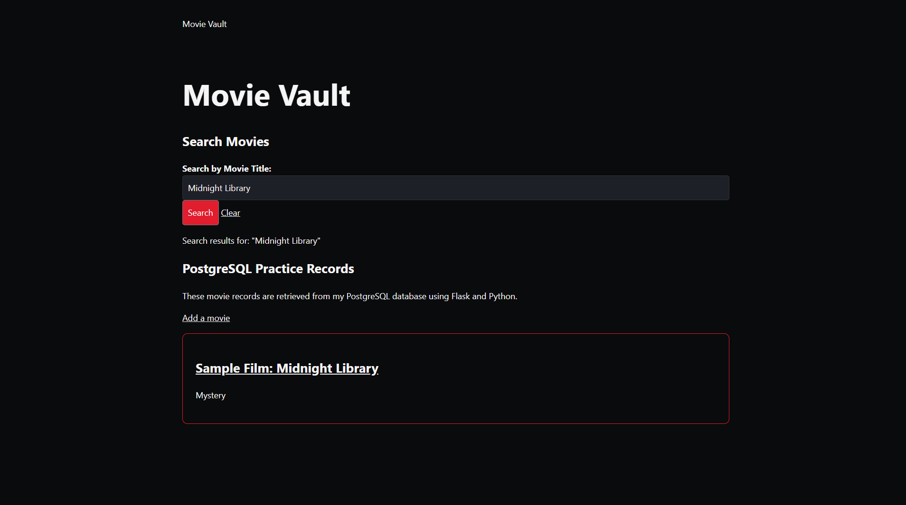
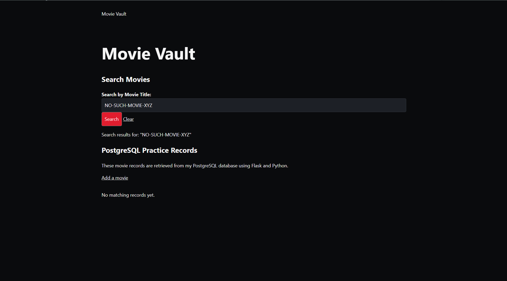
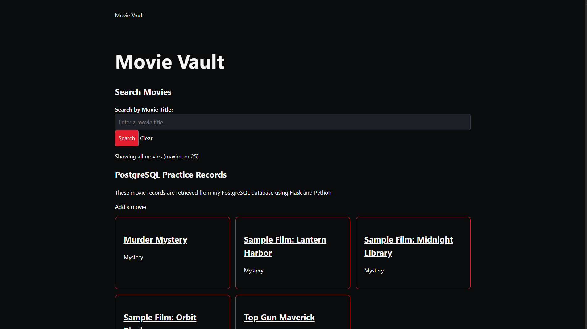
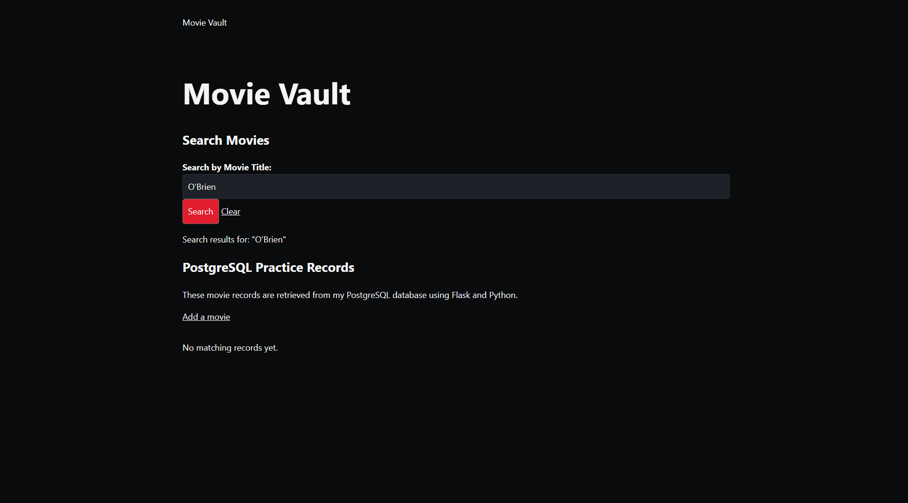

## Activity Questions

1. On http://127.0.0.1:5000, choose Manager from the View menu, then open Claim search. Leave Search text blank, set Status to Open, and click Search. Copy one returned claim ID into lesson-notes.md.

Claim ID = CLM-0047856

2.On the local Claim search page, select a Facility and click Search. Open the source links below and follow facility_id from the menu in claims_search.html, through request.args in the route, to the SQL condition and parameter tuple in search_claims(). Record the file and function at each stage in lesson-notes.md.

    1. templates/claims_search.html — The Facility dropdown uses facility_id as the field name. The selected option provides the value.

    2. portal/__init__.py — The Flask route reads the selected facility_id from request.args and places it into the filters dictionary.

    3. portal/repository_postgres.py — The search_claims() function uses the facility filter in its parameterized SQL query. The parameters tuple supplies values corresponding to the SQL placeholders.

3.Set Facility to All facilities and Status to All statuses. Search for NO-SUCH-CLAIM-XYZ. Then try O'Brien. Use Clear afterward. These checks belong in your local copy.

After proforming the checks, I was returned with "0 rows returned

4.Follow the Network instructions. Repeat one search, select the /claims document request, and record the method, one query-string value, and the HTML response type.

After selecting a Facility and clicking Search, the browser sent a GET request to /claims. One query-string parameter was q=+-NO-SUCH-CLAIM-XYZ, as shown in the Network tab. The request returned a 200 OK status, and the response was a full HTML document (text/html). The address bar also changed because the form uses a GET request to navigate to the results page

## M07 Search and Filter Submission

A parameterized search function and the GET form that calls it.

For my MovieVault project, I added a search bar that allows users to search for movies by their title. I updated app.py, repository_postgres.py, and index.html to make this work. The search uses a GET request to send the user's input to Flask, which then searches my PostgreSQL database. I used a parameterized query to make sure the input is handled safely.

Search Form

Flask Route

Parameterized Search Function

Evidence of one matching search and one empty result, along with the four test cases.

Test 1 - Normal Match

For the first test, I searched for "Midnight Library," which is a movie I previously added to my database. The search successfully returned the movie, showing that the search bar is connected to PostgreSQL and can retrieve matching records.

Test 2 - No Match

For the second test, I searched for "NO-SUCH-MOVIE-XYZ," which does not exist in my database. The search returned no matching movies instead of giving an error. This shows that the website can handle searches that have no results.

Test 3 - Blank Input

For the third test, I left the search bar empty and clicked Search. The website displayed the available movie records in my database. This allows users to see all available movies without having to search for a specific title.

Test 4 - Special Character

For the fourth test, I searched for "O'Brien" to see how the website would handle an apostrophe. The search worked without causing an error. This shows that the parameterized query can handle special characters in the user's input.

Result order and maximum number of results.

I decided to have the movies displayed in alphabetical order by their title, from A to Z. If two movies have the same title, they are ordered by their movie ID. I also limited the search to a maximum of 25 results so the page does not display too many movies at once.

Problems and next action.

One problem I ran into was getting the search bar to appear on my website. I had some confusion with the HTML files and uploading the correct file to the King's server. After fixing this, I was able to get the search bar working and complete all four tests.

My next action is to continue improving the MovieVault website and work on adding more features to the database.

AI-use note: I used ChatGPT to help write the search function, update the Flask route, and add the search bar to my HTML file. I also used it to troubleshoot problems with the server and HTML files. I completed the four search tests myself to verify that everything was working.