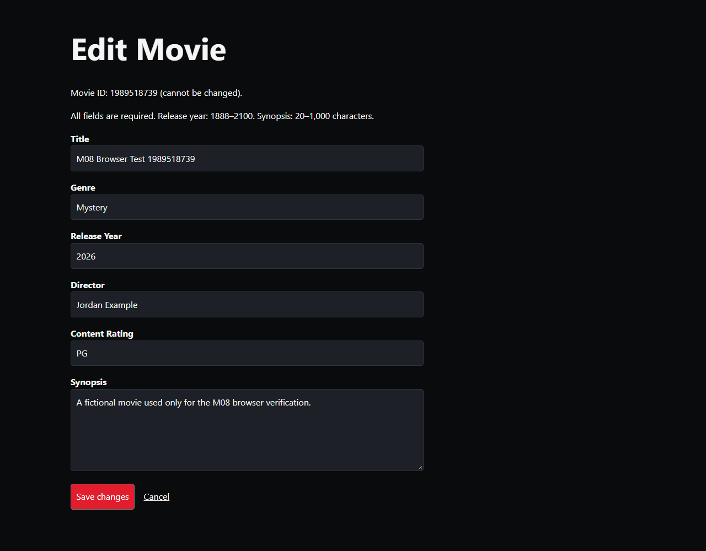
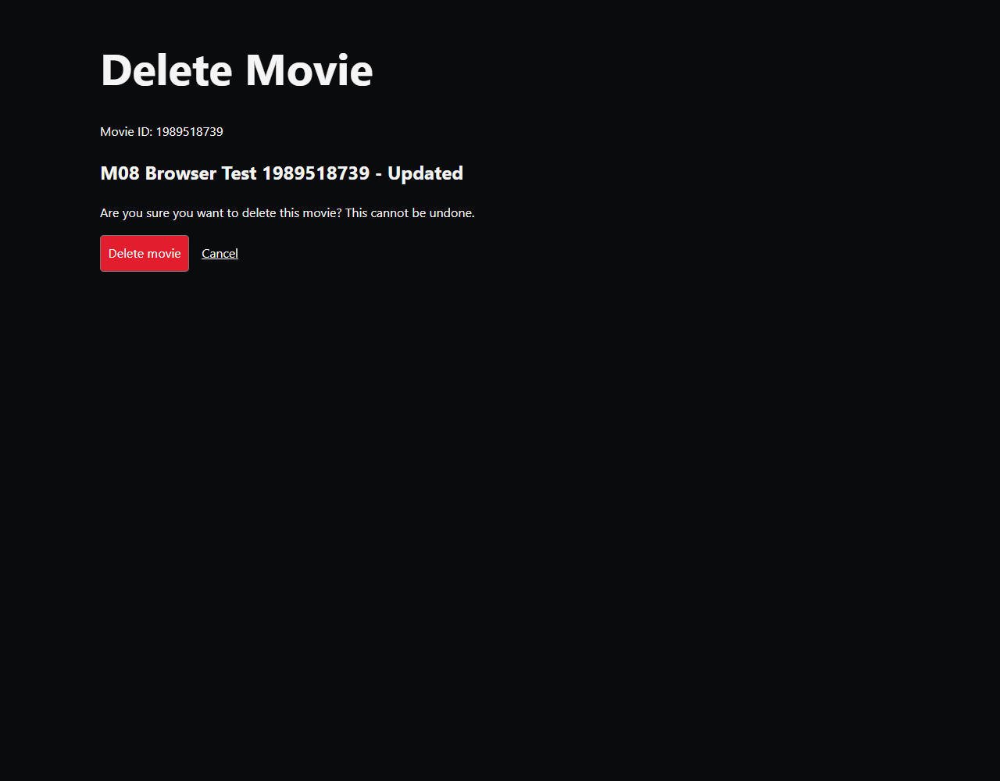
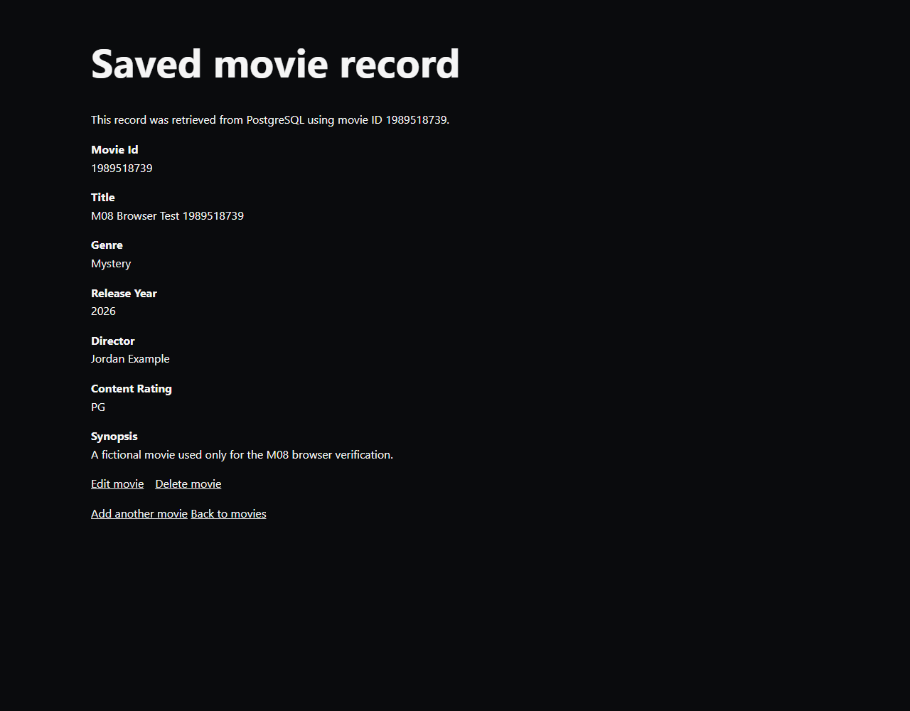
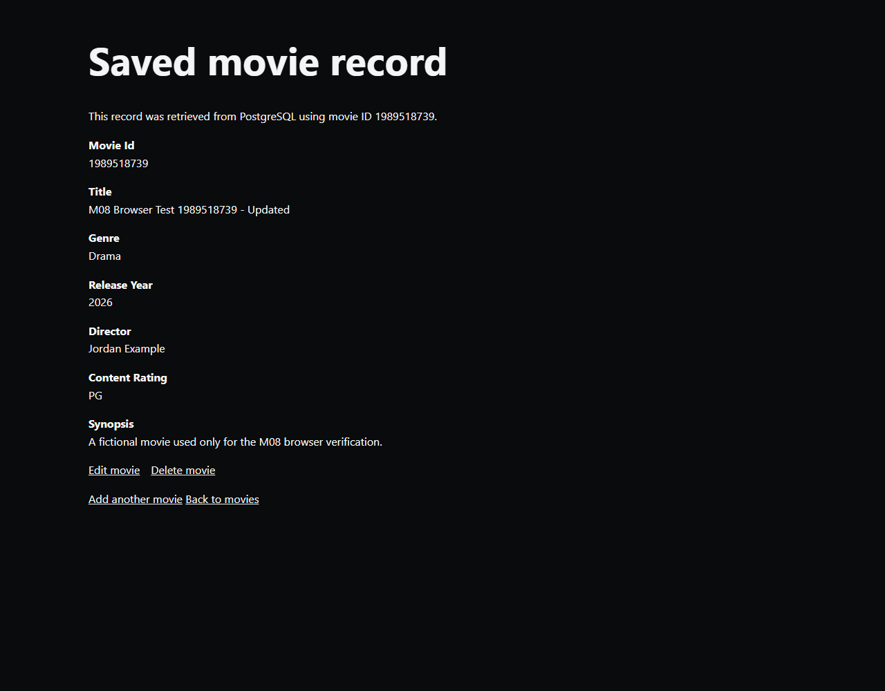
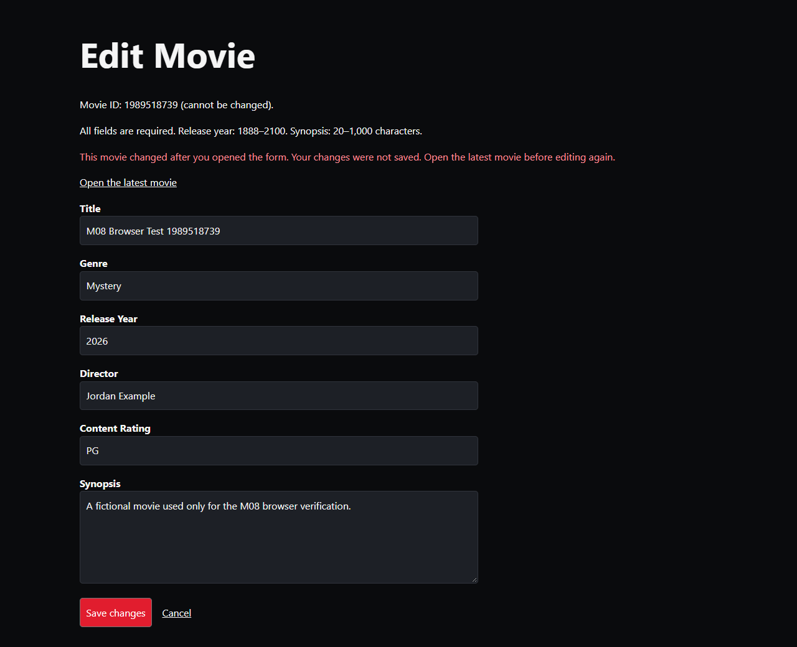

## Activity Questions

1. Record ID: The disposable local record was created and tested for employee E0001234.

2. Update, Cancel, and Older Version: When I updated the record, the changes saved successfully, and the ID stayed the same. When I clicked Cancel, the record was not deleted. When I submitted an older version after the record had changed, the system returned a 409 Conflict error and prevented the newer information from being overwritten.

3. Project Progress: For my MovieVault project, I previously completed the movie search feature using Flask and PostgreSQL. 

4. Questions or Problems: The edit and delete features are now implemented and tested in my MovieVault project. No remaining problems from these tests.

5. Next Action: My next step is to review my M08 screenshots and submit the completed work. I would also like to clean up some minor changes, like add padding to the search button.

## M08 CRUD Workflow

1. The edit and delete routes, the parameterized SQL, and the confirmation interface.

For MovieVault, I added edit and delete pages using GET and POST routes. The edit form starts with the saved information and uses my existing validation. The movie ID stays the same. Both SQL statements use `WHERE movie_id = %s` with separate parameter values and check that exactly one row changed. After saving, the page returns to the movie details. Deleting requires confirmation and returns to the movie list. Movies with related reviews cannot be deleted.

- [Flask routes](../backendconnection/app.py)
- [Parameterized UPDATE, DELETE, and version check](../backendconnection/repository_postgres.py)
- [Existing validator](../backendconnection/validation.py)
- [Edit form](../templates/edit_movie.html)
- [Delete confirmation](../templates/delete_movie.html)

2. Before-and-after database evidence for one update and for either a completed deletion or a canceled deletion.

I used disposable movie **1989518739** for the browser test. Separate PostgreSQL queries on King's checked the record before and after each action. These are the measured results from the [browser and database verification output](M08-browser-verification.json):

| Check | Before | After |
| --- | --- | --- |
| Movie ID during update | 1989518739 | 1989518739 |
| Title | M08 Browser Test 1989518739 | M08 Browser Test 1989518739 - Updated |
| Genre | Mystery | Drama |
| Cancel deletion | Updated record present | Same record and values present |
| Confirm deletion | Updated record present | No matching row |

The [separate server checks](M08-verification.json) also passed using another disposable movie. They checked invalid input, missing movies, search, repeated detail requests, and a foreign-key restriction. All five existing movies and their reviews stayed unchanged. The test movies and test review were removed.

3. A short result from the cancel test and stale-form test.

In the automated Chrome test, clicking Cancel returned to the movie details without changing the database record. Two tabs opened the same edit form. Tab A saved successfully, and submitting Tab B's older form returned **HTTP 409 Conflict**. PostgreSQL still contained Tab A's changes. An older delete confirmation also returned 409 without deleting anything. The app compares the form's fingerprint with the current row while holding a lock inside the transaction.

The 31 local tests passed using mocked database calls. The linked JSON files contain the separate real PostgreSQL and browser results. [M08_SETUP.md](../M08_SETUP.md) has the commands to repeat these checks.

AI-use note: I used Codex/AI to assist with implementing, testing, and documenting this assignment. Codex ran the local tests, the King's PostgreSQL checks, and the automated Chrome tests, and captured the screenshots. These were automated checks, not manual browser tests that I performed myself.
