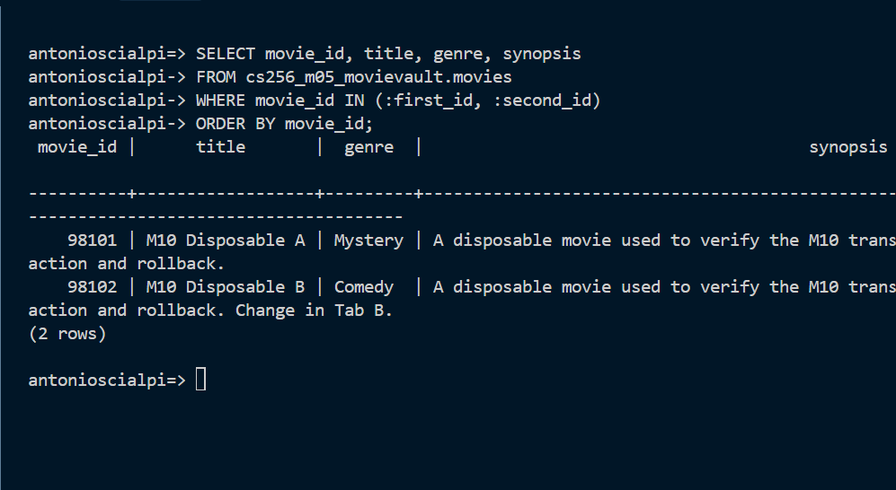
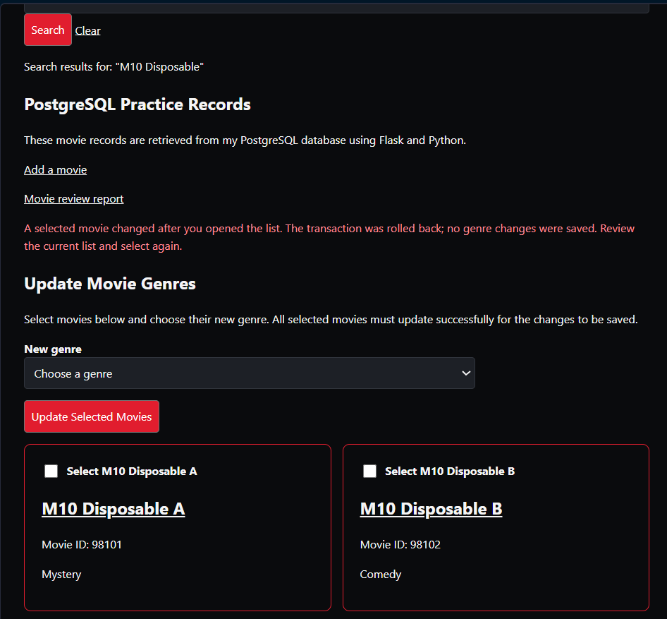
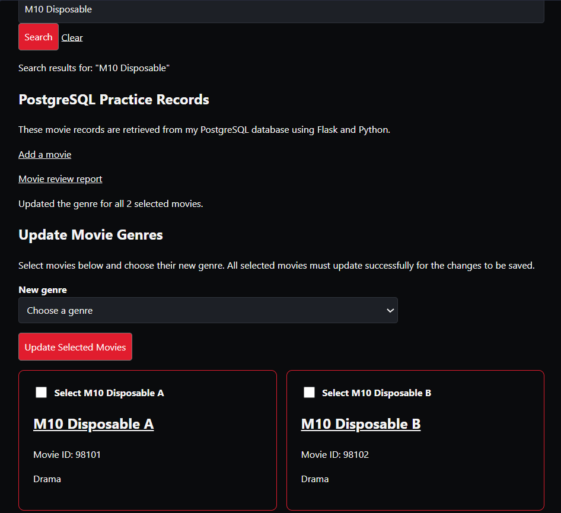

## Activity Questions

1. 
Transaction Practice A IR- ID = IR-20261111-75C5322A
Transaction Practice B IR- ID = IR-20261111-59A8934C

Both Submitted
URL for Manager view - http://127.0.0.1:5000/incidents?facility_id=

2. Change One Record in Tab B: I edited one report in tab B and added "Changed in tab B" to its description. The changes were saved, but tab A still displayed the older version.

3. Submit the Stale Selection: When I tried updating both reports to Under Review in tab A, a version conflict occurred. Neither report's status changed, and the updated description remained saved.

4. Retry with Current Versions: After refreshing the manager list, I selected both reports again and changed their statuses to Under Review. This time, the update succeeded because both records had current versions.

Result: This activity demonstrated how transactions prevent partial updates and how version checking protects records from conflicting changes.

## M10 - Transaction and Rollback

The activity answers above describe the class practice. The tests below were
completed with MovieVault and the actual PostgreSQL database on King's.

### 1. What I Worked On

I added a bulk genre update to the MovieVault home page. Users select movies,
choose a genre, and click **Update Selected Movies**. This lets users change
several movies at once instead of opening each movie's edit form. The function
`update_movie_genres()` in
[repository_postgres.py](../backendconnection/repository_postgres.py) uses one
PostgreSQL connection and `with conn.transaction():` for the whole operation.
The form in [index.html](../templates/index.html) sends the selected movie IDs,
genre, and record versions to `/movies/genres` in
[app.py](../backendconnection/app.py).

The function validates the selection and genre before connecting. It processes
movies in ascending movie ID order. For each movie, it uses `SELECT ... FOR UPDATE`
and the existing version fingerprint to check that the record still exists and
has not changed. It then runs a parameterized UPDATE and checks that exactly one
row was affected. The Flask route handles errors after the transaction exits.

The row lock prevents another update from changing that movie while this
transaction checks and updates it. The version fingerprint is based on the
movie's saved fields. Comparing it with the version from the form detects
whether someone changed the record after the list was opened.

### 2. All-or-Nothing Rule

If any selected movie cannot be updated, none of the genre changes from that
attempt should be saved. The transaction commits only after every movie passes.
An error leaves the transaction block and causes PostgreSQL to roll back the
attempt. This prevents a bulk request from saving only some of its changes.

### 3. Test 1 - Intentional Failure and Rollback

I first checked that IDs 98101 and 98102 were unused, then created two disposable
movies: **M10 Disposable A (98101)** with genre **Mystery**, and
**M10 Disposable B (98102)** with genre **Comedy**.

I opened the movie list in two browser tabs. In Tab A, I selected both movies
for a Drama update. In Tab B, I edited the higher-ID movie's synopsis and added
`Change in Tab B.` while leaving its genre as Comedy. I saved that edit, then
captured the PostgreSQL results before submitting the stale selection in Tab A.



This screenshot shows the database after the edit in Tab B but before the bulk
update. The movies still have their original genres, and the higher-ID movie
already contains the saved synopsis change.

Without refreshing Tab A, I submitted the bulk update. The application displayed:

> A selected movie changed after you opened the list. The transaction was rolled back; no genre changes were saved. Review the current list and select again.



Because the function checks and updates movies in ascending ID order, it updates
98101 before discovering that 98102's version is stale. That conflict causes the
transaction to roll back the first movie's attempted genre change. The database
results before and after the failed operation were identical: 98101 remained
Mystery and 98102 remained Comedy. The second movie still contained
`Change in Tab B.` because that edit committed separately before the bulk attempt.

### 4. Test 2 - Successful Retry

After reopening the movie list with current versions, I selected the same two
movies and chose Drama again. Before submitting, Codex saved a fresh PostgreSQL
query result and confirmed it matched the after-rollback result.

This time the application reported, "Updated the genre for all 2 selected movies."
Both movie cards displayed Drama. The PostgreSQL check after the retry confirmed
that both stored genres were Drama and the separately saved Tab B synopsis was
still present. Both updates committed together.



The screenshot shows the success message and both movie cards. The saved
PostgreSQL results below confirm that these changes were stored in the database.

### 5. Before-and-After Database Results

These are actual results from `cs256_m05_movievault.movies` in the
`antonioscialpi` database on King's. I opened PostgreSQL with
`psql -X -d antonioscialpi` and entered 98101 and 98102 using:

```sql
\prompt 'Lower test movie ID: ' first_id
\prompt 'Higher test movie ID: ' second_id
```

The same query was used for all four checkpoints:

```sql
SELECT movie_id, title, genre, synopsis
FROM cs256_m05_movievault.movies
WHERE movie_id IN (:first_id, :second_id)
ORDER BY movie_id;
```

The saved query outputs are included below. Codex ran the retry queries in a
separate PostgreSQL session with the same IDs.

Before Failure

Saved query result: [M10BeforeFailure.txt](MileStoneImages/M10BeforeFailure.txt).

```text
 movie_id |      title       |  genre  |                                       synopsis
----------+------------------+---------+--------------------------------------------------------------------------------------
    98101 | M10 Disposable A | Mystery | A disposable movie used to verify the M10 transaction and rollback.
    98102 | M10 Disposable B | Comedy  | A disposable movie used to verify the M10 transaction and rollback. Change in Tab B.
(2 rows)
```

After Failure (Rollback)

Saved query result: [M10AfterRollback.txt](MileStoneImages/M10AfterRollback.txt).

```text
 movie_id |      title       |  genre  |                                       synopsis
----------+------------------+---------+--------------------------------------------------------------------------------------
    98101 | M10 Disposable A | Mystery | A disposable movie used to verify the M10 transaction and rollback.
    98102 | M10 Disposable B | Comedy  | A disposable movie used to verify the M10 transaction and rollback. Change in Tab B.
(2 rows)
```

Comparing these two results shows that the failed bulk update saved neither
genre change. The independently saved synopsis change was kept.

Before Successful Retry

Saved query result: [M10BeforeRetry.txt](MileStoneImages/M10BeforeRetry.txt).

```text
 movie_id |      title       |  genre  |                                       synopsis
----------+------------------+---------+--------------------------------------------------------------------------------------
    98101 | M10 Disposable A | Mystery | A disposable movie used to verify the M10 transaction and rollback.
    98102 | M10 Disposable B | Comedy  | A disposable movie used to verify the M10 transaction and rollback. Change in Tab B.
(2 rows)
```

This fresh query returned the same values as After Failure, confirming that
the movies were still Mystery and Comedy before the retry.

After Success

Saved query result: [M10AfterRetry.txt](MileStoneImages/M10AfterRetry.txt).

```text
 movie_id |      title       | genre |                                       synopsis
----------+------------------+-------+--------------------------------------------------------------------------------------
    98101 | M10 Disposable A | Drama | A disposable movie used to verify the M10 transaction and rollback.
    98102 | M10 Disposable B | Drama | A disposable movie used to verify the M10 transaction and rollback. Change in Tab B.
(2 rows)
```

Comparing the retry results shows that both genres changed to Drama while
both synopses stayed the same. This confirms that the retry saved both updates.

### 6. Testing

The transaction implementation was kept unchanged for this correction. Earlier
local testing passed all 52 unit tests, including 14 bulk-update tests. Those
tests used mocked database calls. Earlier browser layout checks at 1280px and
390px also used synthetic rows and mocked writes. The PostgreSQL results above
provide the actual database evidence for this revision.

| Check | Actual outcome |
| --- | --- |
| Failed bulk update | The application displayed a conflict. Before Failure and After Failure show the same two rows, with Mystery and Comedy unchanged. |
| Separately saved edit | Movie 98102 still contains `Change in Tab B.` after both the rollback and successful retry. |
| Successful retry | Before Retry shows Mystery and Comedy. After Success shows Drama for both movies. |

### 7. Lab Reflection

I completed the stale-record test and successful retry through the MovieVault
interface. When I accidentally closed VS Code, I restarted Flask and the SSH
tunnel. The saved rollback evidence was preserved, and a fresh query confirmed
the same database values before the retry.

Both before-and-after comparisons are now recorded. My next action is to review
the corrected milestone and evidence, then commit and push the revision and
submit its specific GitHub commit link.

### 8. AI-Use Note

I used Codex to help review the code and earlier milestones, implement the
transaction feature and local tests, and prepare the testing instructions.
For this correction, Codex helped upload the existing application, troubleshoot
the connection, collect and compare actual PostgreSQL outputs, and update this
document. I created the disposable movies, performed the browser edits and
bulk updates, and captured screenshots. Codex ran the before-retry and
after-success database queries. The results above came from the actual King's
database.
